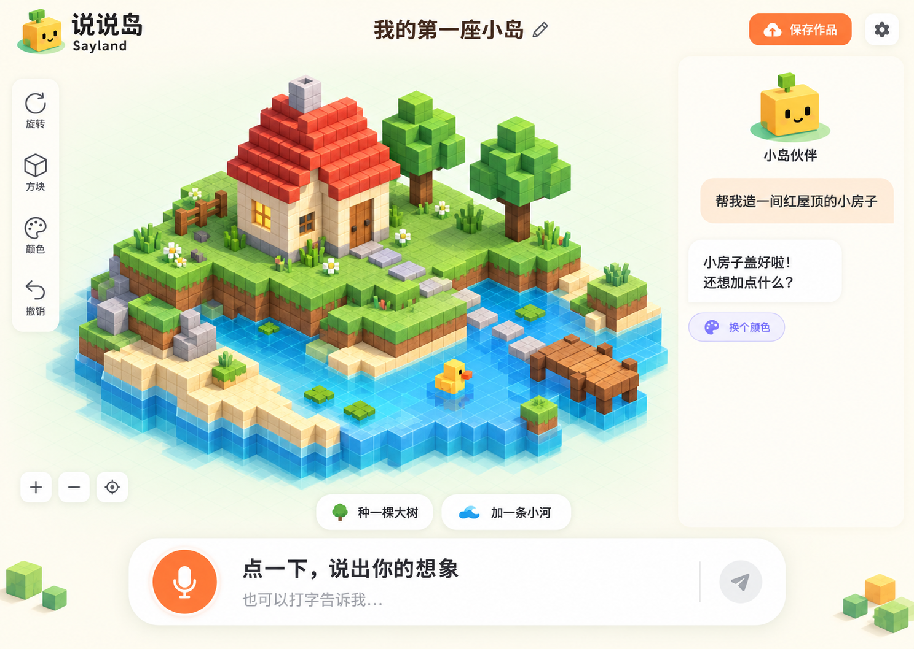

# 说说岛 · Sayland

状态：用户已确认 UI 小稿、独立后端及首版开发。应用和真实模型/语音适配已实现，待用户体验验收。运行入口见 `README.md`，实际调用链和验证边界以 `PROJECT_MAP.md` 为准。

核查日期：2026-10-11。

## 当前入口约定（2026-10-11）

打开／刷新地址先进入卡通项目首页：黄色小伙伴、云朵、圆润项目卡与模板插画；选择已有项目，或选择空白／默认小岛创建。项目卡优先显示上次正常退出时的真实场景渲染图，没有封面时显示初始模板插画；退出存在未保存内容时提供保存／不保存／取消，不保存保留旧封面，已自动保存模型不回退。编辑器中只能返回首页，新建入口仅在首页。用户已明确选择自动保存，展示保存中、已自动保存、失败／重试；取消原手动保存按钮。后端保存与离页任务语义以[工作区说明](apps/api/WORKSPACE.md)为当前约定，下方首版浏览器权威／无数据库描述仅保留历史设计背景。界面已实现，视觉效果待用户验收。

## 已确认目标

- 自由创造的 3D 体素世界：小朋友用中文说话，搭建房子、树木、动物等，能够接着说话修改已有作品。
- 创作不受固定物件词表限制；孩子可以自然表达复合想法。系统应先检查实际场景并修正自身规划错误，不能用“换个小一点的想法”代替规划能力。
- 使用 DeepSeek；用户授权复用同机「创想生成器」的配置密钥。当前实际配置模型为 `deepseek-flash`。
- 小米 ASR / TTS；用户授权使用 Pingoo UAT 的测试密钥。授权不包括生产数据访问、部署或修改原项目。
- 可爱、适合儿童的界面。暂以 6–10 岁、桌面及平板为设计假设，手机保留可用布局；年龄不是用户已经确认的限制。
- 用户已允许并行子任务。体素/渲染、服务端、UI 已并行完成，由主代理联调。

## 界面方向



此图是内置 imagegen 生成的设计小稿，不是已运行的应用截图。图中的房子、地形、树木与河流都应实现为可编辑 Three.js 体素；不能用整张效果图伪装 3D 交互。

- 奶油色背景、草绿与水蓝场景、橙色主按钮，深色圆润文字；保持足够对比度。
- WebGL 画布覆盖完整视口；标题、左侧工具、底部伙伴对话及输入均悬浮在画布上，浮层间的空隙可继续操作小岛。
- UI 尺度独立于画布：桌面主控件48px、作品标题18px、对话正文14px，伙伴区最大宽780px；顶部操作同一基线，左侧工具成组，视角控制位于右下方。各面板的收起箭头放在所属表面内，避免独立减号散落；窄屏换行、短横屏并排回复与输入，保留全部入口。
- 作品栏、工具栏、视角控制、灵感建议和伙伴交互均可独立收起，伙伴交互收为小人入口；右上角一键收起界面，点击恢复或按 Esc 回到之前的展开状态。形变采用轻弹簧，内容淡入淡出但文字不拉伸；收放保留草稿、对话与小岛视角，进行中的录音/任务保留可展开的状态入口。
- 按住伙伴或空格键说话，录音就绪后松开发送。录音中清楚显示状态和取消入口；不默认持续监听。
- 完整计划校验提交后，方块以可看清过程的整体动画落位；取消停止未提交修改，孩子可以一键撤销整次口述产生的更改。
- 对话区以真实执行结果说话，只有场景确认提交才回复“盖好啦”。
- “保存作品”首版保存到本机，并支持 JSON 导入/导出；概念图里的图标不表示云存储。
- 对话与输入共用底部同一个伙伴气泡：最新回复常驻，完整历史向上展开，不再另设右侧角色。场景始终可见，整个交互区由用户决定收放。触控目标至少 48px，支持减弱动效。
- 左下角小窗实时显示本轮搭建动态：真实观察/设计/校验/搭建阶段、伙伴的公开说明和最终结果。窄屏收为可展开入口；手动翻看时暂停自动跟随，结束后保留本轮记录。没有新事件时不制造假进度，不展示模型内部推理正文。

## 已采用实现

React + TypeScript + Vite，Three.js 通过 React Three Fiber 管理场景；Node.js + TypeScript + Fastify 独立 API 服务负责 DeepSeek 与小米调用。前后端各自启动、构建，可以独立部署，首版在同一工程管理。当前锁定 React 19.3、R3F 9.8.1、Three.js 0.186.1、Vite 8.3.4、Fastify 5.12.5；完整依赖以 package-lock.json 为准。Vue 3 + TresJS 也能实现；当前是空目录，没有需要沿用的 Vue 代码，因此推荐 React。

不新增数据库、账户系统或云部署。场景先本地保存，服务仅监听 loopback；未来公开部署时另行设计鉴权与费用边界。当前目录非 Git 仓库，不擅自初始化、提交或推送。

### 独立后端职责与工程边界

已建立独立 API 进程，同一项目内目录边界如下。

| 目录 | 职责 |
| --- | --- |
| `apps/web` | React 界面、Three.js 渲染、录音/播放、场景操作及本地作品保存 |
| `apps/api` | Fastify HTTP API、DeepSeek 对话编排、小米 ASR/TTS、密钥配置、请求会话与资源限制 |
| `packages/scene` | 确定性体素内核、几何运算、事务、撤销与重做；无浏览器或提供商依赖 |
| `packages/protocol` | 共享数据类型、运行时校验、接口与事件契约；不依赖 React/Three.js，不包含密钥 |

Fastify 提供路由校验与模块化组织；校验规则由应用代码固定维护，模型仅提供数据，不能提交可执行 schema。选择它是为了明确 HTTP 边界和测试能力，不宣称未经测量的性能优势。相比原生 HTTP，增加一项框架依赖但减少重复的路由、校验和错误处理；NestJS 也是可行替代，首版单个 API 进程暂不需要其更完整的模块/依赖注入体系。

后端处理录音转写、模型规划、完整工具调用校验、提交回执、简短结果生成及语音合成；管理超时、取消、并发、用量和脱敏错误。请求过程中的临时音频与会话应及时回收。浏览器不直接持有或调用提供商密钥。

首版浏览器仍是单用户作品的数据权威，后端发来的命令须经浏览器事务提交并返回真实结果；服务端接受请求不代表画面已建好。回执超时标记为结果未知并核对同一请求状态，不能用新请求 ID 盲重发。首版不承诺后端重启后恢复生成任务，已保存作品保留，任务显示中断。

AI 状态和完整操作批次通过 HTTP 流式响应送达；确认、取消与请求状态查询使用独立请求。首版短句 ASR 不要求 WebSocket。未来确需麦克风双向实时流，再依据小米实际服务能力增加对应传输。

独立后端会增加一个进程和接口集成检查，但使凭据、供应商切换、请求控制及后续部署集中管理。前端的手动搭建、已有作品查看及本地保存不依赖 AI 服务在线。将来云备份可以保存版本快照；多人同时编辑需要另行确定服务端权威及冲突规则，不在首版隐含加入。

验证边界增加：后端独立启动和构建、使用测试适配器执行接口契约与取消测试、前后端真实提交回执联调。当前仍无发布或公网部署授权。

### 一次对话的调用链

```text
点击录音 → 浏览器采集 → 本地语音适配器 → 小米 ASR
  → 识别文字（也可直接打字）
  → DeepSeek：用户要求 + 通用场景摘要 ↔ 真实占位查询
  → 完整结构化操作 → 隔离副本预演 ↔ 具体错误反馈及完整计划修正
  → 校验通过 → 浏览器内核提交 → Three.js 更新 + 操作历史
  → 摘要 ACK → 简短结果回复 → 小米 TTS 播放
```

ASR、生成与朗读独立可取消。开始下一次录音时停止旧朗读，避免应用识别自己发出的声音。ASR/TTS 不可用时明确提示并保留文字创作，不伪装语音成功。

### 场景与大模型边界

- `SceneSnapshot` 保存对象/部件稳定 ID、整数坐标、实际方块与颜色；渲染资源不作为数据源。
- 大模型调用受限工具，不执行模型输出的 JavaScript、着色器或外部资源地址。
- 基础元素可用参数化生成缩短等待；任意造型保留体素切片和稀疏补丁，不能把自由创造限制成固定模板选择器。
- 支持新增、局部改色、整格移动和删除；“屋顶改成蓝色”只更改屋顶，保护其余内容及手工编辑。
- 每批先完整接收、校验再提交；半截 JSON、越界参数、冲突与超限不改变当前场景。
- 模型可以先查真实占位，在隔离副本中预演并修正完整计划；最终只提交一次。修复不得丢掉复合请求的部分目标。世界/局部坐标换算与预期附着关系需要自检；几何合法不等于造型符合意图，仍需真实模型与视觉回归。
- 用请求 ID 与场景 revision 防止重复执行和旧响应覆盖新操作；一轮语音修改合为一次撤销，重做无需再次请求模型。
- 浏览器内核为场景权威时，模型工具的成功结果必须等浏览器提交回执后再返回；生成期间的文字不能提前作为成功语音播放。
- 首版每轮仅接受一批完整操作，不解析半截流式 JSON。内核支持按轮组织历史；取消保留已提交部分，撤销整轮可恢复原样。正在生成的作品不自动清空。
- 坐标、候选体积、每批工作量和上下文有界；具体性能与容量阈值通过样本场景测量，不预先承诺帧率。

### 复用已有工程的范围

源项目「创想生成器」已核对 `src/core/protocol.ts`、`src/core/engine.ts`、`server/config.ts` 与 `server/deepseek.ts`。引擎本身不依赖 UI/Worker/Three，但会导入世界查询、空腔分析与三视图附件。已选择性提取并适配最小内核，保留严格契约、原子变更、稳定 ID、请求幂等及整轮撤销；没有迁入源项目的空腔分析与三视图调度，Sayland 现有 `inspect_scene` 使用自己的快照做有界占位查询。不直接搬入专业工作台 UI、旧服务启动方式或全部上下文调度。两个源项目均不修改。

DeepSeek 配置来自同机源项目的 `.env.local`，已按授权单独存入 Sayland 服务端本地忽略文件 `.env.local`，权限 0600，未输出密钥；前端只获得已配置状态。不给密钥加 `VITE_` 前缀，也不写入场景、日志或测试快照。

### 渲染与资源

使用共享方块几何体和 `InstancedMesh` 批量绘制；实例槽位映射到稳定方块 ID。增删后同步拾取映射与包围体。按需更新脏数据，静止时按需渲染；交互和搭建动画完成后停止动画循环。拆卸场景清理自建材质、几何体、监听器与计时器。

### 语音适配边界

先以统一应用接口隔离提供商：`transcribe(audio, signal)` 返回识别结果，`synthesize(text, signal)` 返回音频及 MIME 类型；仅在提供商确实支持时上报文本片段。不把响应文字 SSE 等同于实时麦克风双向流。

浏览器采集格式和提供商输入格式必须明确转换，不能把 WebM 改后缀当 WAV。首版优先短句录音、结束后识别；TTS 播放失败允许重试。麦克风轨道、AudioContext、请求、音频对象 URL 在结束、取消和卸载时释放。

Pingoo 的业务语音接口带有账号、额度和应用校验，Sayland 直接通过自己的服务端小米适配器接入，不绕过或复制 Pingoo 的业务权限。

已核查 `Pingoo_AI/pingoo-server/src/speech/mimo-asr.provider.ts::MiMoASRProvider`：使用 `MIMO_API_KEY`、可选 `MIMO_BASE_URL`，默认小米官方 `/v1/chat/completions`，模型 `mimo-v2.5-asr`，完整 Base64 WAV，非流式返回。Pingoo 自己要求 16kHz / 单声道 / 16bit PCM WAV；Sayland 可沿用此录音格式，但不能把 Pingoo 的大小限制当作小米平台限制。

未在核查范围发现 Pingoo 的 MiMo TTS 实现；其当前实时 ASR 是豆包。小米公开 `mimo-v2.5-tts` 接口可单独接入，已以当前授权账号、默认音色执行真实合成和识别往返，详见 API 说明。

用户已明确确认本机 `Pingoo_AI/pingoo-server/.env` 即本次允许使用的小米测试密钥来源。仅复制必要配置到本工程，未修改源项目、读取生产配置或要求聊天发送密钥。

## 实施分工与验收

已按边界并行：体素内核/渲染、DeepSeek/语音服务、儿童 UI/交互；共享协议先确定，避免多人编辑同一文件。主代理完成集成与实际浏览器检查。

首版验证与后续体验验收清单（已执行项目详见 `PROJECT_MAP.md`，未执行项不视为通过）：

1. 真实 DeepSeek 生成一个房子；接着改屋顶颜色、添加树、移动对象，只修改对应范围。
2. 撤销、重做、保存、刷新恢复；失败、取消、重复响应均不破坏已保存作品。
3. 真实小米 ASR 输入与 TTS 输出分别验证，再验证完整“录音→搭建→朗读”；服务端音频通过不等同于用户设备麦克风验收。
4. 检查主桌面尺寸、平板触控布局、手机窄屏和键盘访问；效果图与实际渲染直接对照。
5. 正式设备性能验收后续使用固定 1k/5k/10k 方块样本测旋转、拾取、批量修改及资源趋势；当前未给出帧率或内存稳定性承诺。
6. 只运行与修改相关的契约/引擎测试、类型检查、构建和浏览器交互；结束后关闭独立测试服务与标签页，删除临时录音、日志与截图；仅保留用户可查看的预览服务、交付截图、正式设计稿和源码。

## 来源与未验证项

- [R3F 官方兼容性说明](https://r3f.docs.pmnd.rs/getting-started/introduction)：React 19 / R3F 9。
- [Fastify 校验与序列化](https://fastify.dev/docs/latest/Reference/Validation-and-Serialization/)：固定接口 schema 与输入/输出校验；2026-10-11 核查。
- [Three.js InstancedMesh](https://threejs.org/docs/pages/InstancedMesh.html)：实例变更、包围体与资源管理。
- [R3F 性能指南](https://r3f.docs.pmnd.rs/advanced/scaling-performance)：按需渲染和资源复用。
- [TresJS 安装说明](https://docs.tresjs.org/getting-started/installation)：Vue 方案为可选替代。
- [DeepSeek Tool Calls](https://api-docs.deepseek.com/guides/tool_calls/)：工具参数、结果回传与 Beta strict 限制；本地严格校验不等于提供商 strict 模式。
- [DeepSeek Thinking Mode](https://api-docs.deepseek.com/guides/thinking_mode/)：工具回合的 reasoning 协议；推理内容只在服务端保留。
- [小米 ASR 文档](https://mimo.mi.com/docs/zh-CN/quick-start/usage-guide/audio/Speech-Recognition)：整段音频与文字 SSE 输出。
- [小米 TTS 文档](https://mimo.mi.com/docs/zh-CN/quick-start/usage-guide/audio/speech-synthesis-v2.5)：合成与流式音频。
- [生成设计稿所用提示词](docs/ui-concept.prompt.txt)：内置 imagegen，原始结果已保留。

已完成应用实现与本地集成，验证证据记录在 `PROJECT_MAP.md` 和模块说明。剩余：真实麦克风到朗读的设备体验、任意造型质量、移动设备性能与用户主观验收。未发布、部署或提交，源项目历史测试不计作 Sayland 的验证。
