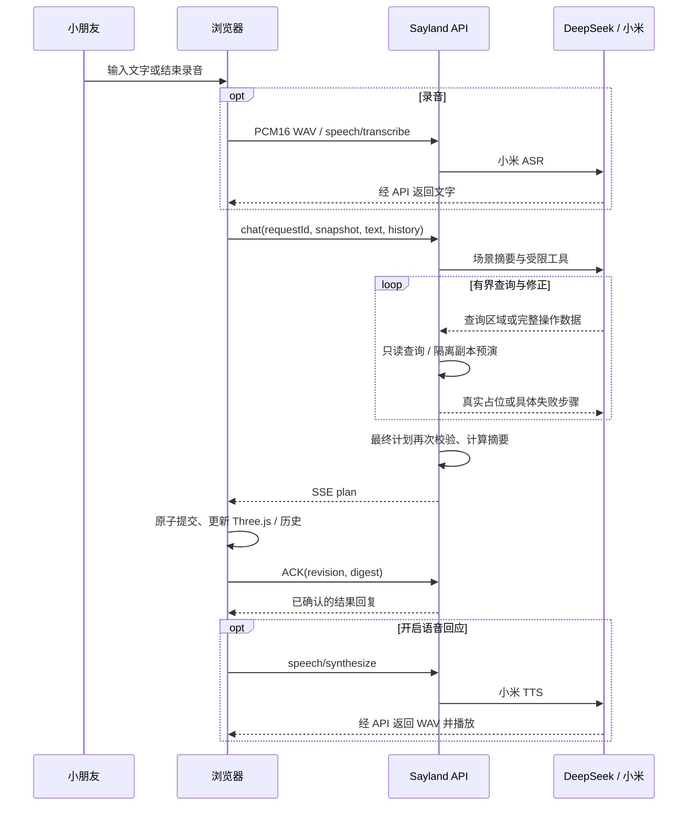

# 实现地图

核对日期：2026-10-11。首版本地实现；Git 主分支为 `main`，远程仓库为 `https://github.com/soBigRice/sayland.git`。尚未部署或经用户完整体验验收。

## 模块入口

| 路径 | 职责与真实入口 |
| --- | --- |
| `apps/web/src/App.tsx` | 组合场景、工具栏、对话、录音输入与设置；隐藏调试入口和懒加载；CanvasBoundary 隔离渲染失败 |
| `apps/web/src/hooks/useWorkshop.ts` | 作品权威、单轮请求状态、ACK、撤销、保存、朗读与取消；debugApply和本页最近回合 |
| `apps/web/src/hooks/useRecorder.ts` | 麦克风生命周期、20 秒上限、WAV16k 转换 |
| `apps/web/public/recorder.worklet.js` | PCM 分块采集与显式 flush，不将录音回放到扬声器 |
| `apps/web/src/lib/api.ts` | 同源 HTTP/SSE、每页 session、ACK 丢包恢复、错误文本解析 |
| `apps/web/src/lib/storage.ts` | IndexedDB 事务提交及数据库连接释放 |
| `apps/web/src/components/SceneShell.tsx` | 全屏画布与悬浮界面、展示组件及受控事件；布局逻辑见下文「全屏布局」 |
| `apps/web/src/components/DebugPanel.tsx` | 隐藏调试面板：物件组/部件树、统计、内核编辑、选择高亮与手动回合诊断 |
| `apps/web/src/components/FloatingPanel.tsx` | 可收放浮层、形变外壳、焦点与隐藏内容命中；状态由 SceneShell 管理 |
| `apps/web/src/styles/styles.css` | 主题、桌面/窄屏布局、焦点和减弱动效 |
| `apps/web/src/scene/SceneCanvas.tsx` | 实例化体素渲染、OrbitControls、拾取、视角与短时搭建动画，详见[渲染说明](apps/web/src/scene/README.md) |
| `apps/web/src/scene/SceneLighting.tsx` / `ScenePostprocessing.tsx` | 自适应方向光阴影、GTAO 去噪、透明色彩输出与 FXAA，复用 Three.js addons；按需渲染与显式资源清理 |
| `packages/protocol/src/index.ts` | Zod 契约、Group/Part归属、整数坐标及容量常量、稳定 SHA-256 快照摘要 |
| `packages/scene/src/engine.ts` | 原子事务、物件组/部件/方块、历史/幂等/序列化；详见[内核说明](packages/scene/README.md) |
| `apps/api/src/app.ts` | Fastify 路由、会话限额、模型预执行、ACK 与语音门禁；详见[API 说明](apps/api/README.md) |
| `apps/api/src/providers.ts` | DeepSeek 工具循环、查询和预演修正；小米官方协议与超时取消 |
| `apps/api/src/scene-context.ts` | 与用户措辞无关的场景摘要、通用世界坐标占位查询与显式分页 |
| `apps/api/src/errors.ts` | 结构化几何诊断、失败步骤及冲突归属、分类后的用户提示 |
| `scripts/dev.mjs` | 前后端进程共同生命周期，关闭时不遗留子进程 |

## 一次创作

浏览器 `VoxelEngine` 是作品权威。模型返回数据，不运行生成的脚本。服务端与浏览器使用同一内核，提交摘要一致才允许完成回复/朗读。一轮创作可进行多次模型查询和预演修正，最终仍仅提交一批完整操作；方块逐步出现是提交后的视觉动画。预演不触碰浏览器作品，不提前朗读完成回复。

`useWorkshop` 流程：`idle → requesting → recording → transcribing → thinking → building → idle`；文字直接进入 thinking。忙碌时锁定场景修改和导入，防止 baseRevision 过期。每轮 requestId 同时作为 historyGroup，撤销不调用模型。

## 失败、取消和恢复

- 参数或几何错误：保持原始快照，将失败步骤、错误类型、冲突位置/部件反馈给模型，要求保留原请求全部目标并重写整个计划。最多 6 次模型调用、4 次查询、3 次计划尝试及 65 秒总时限；权限/网络错误和截断响应不自动付费重试。每次额外模型调用计入限流。
- 只有通过预演的最终完整计划才发给浏览器。仍失败时按真实类别说明是伙伴尚未完成规划，不要求孩子“缩小想法”或迁就特定物件模板。短期 turn 诊断只对本 session 可查，不记录密钥、录音或完整供应商响应。
- 通用查询按世界坐标读取真实占位，每页最多 256 个 X 连续段，并明确是否完整及下一页偏移；包围盒不能代替实心形状。混合颜色的段标记 mixedColor，不推断逐格颜色。
- 停止：立即退出忙碌、关闭麦克风/朗读、取消供应商请求；已提交的部分保留，可一次撤销。旧请求 finally 以 ID 判断，不清理新请求。
- 提交后回执网络失败：`acknowledge` 查询原请求；只有匹配 ID/revision 的 committed 能恢复成功。awaiting_ack 最多重发一次相同回执，不重做场景或重新调用模型，所有恢复共用原超时。
- 已确认 ACK 是提交结果依据；其后 SSE 尾部丢失不能覆盖成功回复或重复提交。取消优先于迟到回执，已取消回合不朗读。
- 服务重启会失去短期会话；保存的作品不丢。前端不把未知状态伪装成完成，已搭好部分保留且可撤销。
- 麦克风许可延迟通过 attempt token 拦截；结束录音有同步锁。取消、超时、卸载都停止 tracks、AudioContext、请求及 Blob URL。关闭语音开关会取消在途 TTS 并禁止旧响应播放。

## 本地数据

作品外层为 `format: sayland-project, version: 1`，含内核 serialize、最多 100 条对话、输入草稿及语音偏好。IndexedDB 在停止修改 600 ms 后保存，也支持手动保存。内核历史最多 50 步 / 100,000 条变更，保留 ID 分配器及请求记录。

导入先校验完整作品与历史，再由用户确认替换；24 MiB 上限。旧备份损坏时保留原存储，当前临时小岛仅允许导出，明确手动保存才覆盖备份。设置恢复初始小岛会再次确认。

## 两层分组与隐藏调试（2026-10-11）

`snapshot.groups`保存`Group{id,name}`，`Part.groupId`表示唯一所属物件；体素继续引用稳定partId并使用世界坐标，不引入嵌套变换。`define_group / assign_part_group / rename_group / translate_group / paint_group / remove_group`统一经过`VoxelEngine.executeBatch`。整组移动一次收集所有成员，统一检查碰撞并同步成员origin；删除组会删除成员及体素，解除归属只改关系。子部件编辑与整轮撤销仍可独立使用。预设明确生成对应组；初始岛为13组、25部件、9211块。

旧快照与历史缺少groups时按空组读取，不推断旧部件归属、不丢弃历史；快照schemaVersion=2、内核version=1保持兼容。组和归属进入历史与规范化摘要，服务端预演和浏览器提交必须一致。完整操作、预算和恢复规则以[内核说明](packages/scene/README.md)为准；回归在`packages/scene/src/groups.test.ts`。

`App`通过`Cmd/Ctrl + Shift + D`或`?debug=1`打开懒加载的`DebugPanel`。面板展示组/部件树、真实体素统计及当前选择，允许移动、改色、归组、新组、组改名、删除、撤销/重做。`onApply → useWorkshop.debugApply → executeBatch → sync → IndexedDB自动保存`沿用作品权威和busy锁，不另建编辑副本；`SelectionBounds`只绘制所选组或部件的已提交世界边界，关闭面板即清选中并卸载面板。

`useWorkshop.recentTurns`只保留当前页面最近5轮的请求ID、文本、本地状态与计划，不进入作品持久化。诊断按钮经`readTurnDiagnostics`手动GET `/api/turns/:id`，沿用当前页面`X-Sayland-Session`且核对回合ID；关闭或切换回合会取消在途读取，无常驻轮询。诊断展示遮挡secret类字段，不提供读取服务端环境变量的接口。相关网络边界测试在`apps/web/src/lib/api.test.ts`；统计与格式化入口为`DebugPanel.sceneStatistics / jsonText`。

## 验证记录

- 首次入库前（2026-10-11）：90 项本地自动测试、TypeScript、独立临时目录中的 Vite 前端及 esbuild API 构建通过；构建仍有既存大包提示。已核对提交范围与凭据排除，临时产物已清理。本次未重跑真实模型、语音或真机体验。
- 分组/隐藏调试阶段：86项自动测试通过；最终状态及样式调整后，npm run build（TypeScript、Vite、API）通过。DebugPanel单独加载（JS 20.67 kB / gzip 6.70 kB）；主JS 1511.19 kB / gzip 430.00 kB，仍有既存大包提示，未据此承诺加载性能。隔离真实模型快照的桌面面板检查通过：整组上移1格并撤销、碰撞整批回滚且revision不变、单部件改色并撤销、手动诊断读取从0次增加到1次、关闭后面板消失。390×844窄屏无横向溢出，面板内部滚动和编辑可用；无新增控制台error，保留既有Three.Clock警告。此为浏览器检查，不是用户真机验收。
- 窄屏聚焦回归：`.debug-sr-only`的绝对定位legend缺少top/left，聚焦下方输入时会把父面板的隐藏溢出滚走。补齐`top:0; left:0`后，面板scrollHeight与clientHeight均为844、scrollTop为0、header top为0；原因与后续检查记录在DEVELOPMENT_NOTES。
- 本轮真实DeepSeek隔离两轮：首轮生成109块、8部件、2组，其中robot为5部件/93块，arch为3部件/16块；经历4次模型调用、1次查询、3次计划，前两次计划的碰撞在隔离预演中被修正。次轮1次调用、0次查询、1次计划，机器人整组上移3格，仅眼睛变绿，拱门保持不变。精确ACK、撤销/重做与序列化历史验证通过。该样例验证显式归组及后续局部编辑链路，不能证明任意造型稳定，也不能代替调试面板和手机UI验收。
- 阴影/AO 阶段：TypeScript 与构建通过（JS 1.36 MB / gzip 381 KB）；桌面/手机宽度实际渲染、旋转/缩放/复位与隔离拾取、三次卸载重建通过。仍有原有 Three.Clock 弃用警告，无最终新增 error；未据此声称真实设备性能或长期资源趋势通过。仅渲染层变化，未复跑付费模型与语音接口。

- 自由创作修正阶段 `npm test`：64 项通过；`npm run build`（含 TypeScript）通过。构建仍提示单 JS 包约 1.32 MB / gzip 370 KB；没有以关闭告警代替优化，也未据此宣称移动端加载性能已验收。
- 无模板请求“帮我搭一个黄色机器人，它有蓝色的眼睛，旁边还有一座紫色的拱门。”经真实预览代理 HTTP → DeepSeek → SSE → 内核 → digest ACK 完成：2 次模型调用 / 1 次查询 / 1 次计划，200 个方块、6 个部件，眼睛与主体相接；单次撤销恢复原几何及部件，已查看实际渲染。它不证明所有任意造型都能正确生成。
- 历史河流复合请求已实际生成过扩展水面及帆船，并保持紫色屋顶与原有非水物件；但重复测试也出现船帆与桅杆跨部件重叠，3 次计划后仍失败。不能把首次成功当作稳定性结论；最终版本再次复测仍失败：6 次模型调用、2 次占位查询、3 次计划，先后出现多工具返回、扩水面与 beach 在 (-17,-2,8) 重叠、参数结构错误及相同重叠。没有提交部分场景，未继续反复抽样。详细原因见 `DEVELOPMENT_NOTES.md`。
- 真实浏览器 + DeepSeek 改蓝屋顶：462 个屋顶方块变色，8,749 个其他方块及所有 ID/坐标/部件不变。导出 JSON 与初始场景精确比对。
- 修复地表高度后，真实浏览器连续种树新增 220 方块 / 2 部件，原有 9,211 方块均保持不变；再一次撤销可回到 9,211。
- 撤销 → 手动保存 → 刷新 → 重做：历史恢复，屋顶重新变蓝。手动涂色仅改变选中的一个方块；添加仅新增一个相邻方块，原有 9,211 方块不变。
- 1440×1024 桌面、1024×768 平板、390×844 手机实际渲染；手机对话可展开，输入和场景均可用。并非真实设备触控验收。
- 小米供应商 TTS→ASR 固定短句往返通过；详见 API 说明。未使用用户真实麦克风，也未验证扬声器主观听感。
- 设计稿对照：奶油色/橙色主按钮一致；左工具/右伙伴/底输入结构一致；方块伙伴视觉一致；画布是可旋转的真实体素；窄屏折叠对话。岛屿形状与软阴影是可实现的首版近似，房屋/植物精细度低于概念图，未宣称像素级复刻。
- 控制台：最终完整刷新后无新增 error；开发中改变 Hook 顺序触发过 HMR 旧状态错误，完整刷新消失。R3F 依赖仍使用 Three.Clock，留下弃用警告，未隐藏警告或修改依赖。
- 待验收：儿童用语连续创作的稳定性、任意造型视觉质量、真实麦克风到朗读全链路及移动设备性能。上限和配置状态不能代替这些证据。

## 当前未完成项与续接（2026-10-11）

目标是自然自由创作，用户无需迁就模板或重新表述有效请求。已实现通用查询、预演纠错、准确错误提示及 ACK 后断流恢复，原有 UI、保存格式、原子提交和整轮撤销保持。上述实现纳入 Git 版本管理；首次提交与推送按用户明确授权执行，不代表功能已全部验收。

本轮已用两次验证后的有证据修复：坐标换算/附着自检，以及前缀新部件的完整有界占位反馈。最终 64 项自动测试及构建通过，真实机器人/拱门成功，但最终河流复合请求仍失败；不能标记“自由创作稳定”完成。最新失败不修改浏览器作品，测试使用隔离初始小岛加紫色屋顶，未替换用户保存的数据。正式设计和交付截图保留，临时测试脚本、场景 JSON 与预览页已清理。

推荐下一步（**待用户批准，尚未实施**）：在后端增加布局解析层，让模型描述造型与相对关系，程序依据真实占位解析落点、避让、表面附着，再输出现有内核批次。保留自由体素造型，不限制物件名称；用户明确坐标不擅自移动，无法满足关系时保留原场景。主要代价是新增布局逻辑与 AI 工具契约，而非继续追加提示词；不改变当前作品持久化格式或 UI。按用户 AGENTS 第3节，核心契约调整先确认。验收需要原句复合请求的连续真实样例、无模板造型及已确认编辑/撤销回归；单次成功不作为稳定性证明。

### 原句“在小岛上加一条小河”的定位与待确认方案

2026-10-11 精确复现：建议按钮与文字/ASR 后续同走 `useWorkshop.send`。真实模型在初始场景只追问、未下发操作；强化执行提示的单变量试验虽产生了有效批次，却在两次碰撞后把水放到岛外，语义仍失败。试验已撤回，预览服务未重启、用户作品未修改。本轮最终代码的 planner/grouping/API/ACK 目标回归 49 项通过；不把 fixtures 通过等同于真实模型目标达成。具体数值与失败判断只记录在 `DEVELOPMENT_NOTES.md` 对应条目。临时模型响应文件、隔离调试页已清理，目标测试进程已退出，保留 4310/4311 交付预览。

隔离内核最小可行性实验已通过：在实际岛体 x[-10,3]、z[-12,-11] 内，以5个现有操作定义水物件/部件、局部挖除28草格和28土格、在y=4写入28水格。保留y=3河床和两侧草岸，所有9155个未选中的原格（含4417个非地形格）逐ID/坐标/色/归属不变；一次撤销恢复原几何/部件/组，重做保留提交ID。省略挖除步骤必报碰撞并整批回滚。此为人工构造的隔离操作可行性证据，不是AI自动规划成功、视觉效果验收或通用空间解析器已经实现；未创建测试文件/服务或修改浏览器作品。

拟评审的范围是**服务端场景编辑工具层**，不是更换 Three.js 或绕过场景内核：

- AI 提交自由局部造型、稳定的物件/部件 ID、创建或编辑动作，以及“位于某物件表面/嵌入某地形/相邻”等明确关系；单部件和整组修改保留已有语义。位置未指定时程序求满足关系的落点，用户指定位置不擅自移动，主动悬浮创作不强制落地。
- 后端根据真实占位做坐标换算、关系校验及必要的地形替换，地形修改必须限定目标部件和区域；例如河道先移除该区域的目标地形格，再写入水体，碰到房屋/树等无关物件不得直接覆盖，也不得把河搬到岛外冒充满足要求。无法完成全部目标时不提交部分结果。
- 输出继续是当前 `SceneBatch`，经过同一预演、浏览器执行、digest ACK、单次撤销与保存；新增调试内容展示目标关系、实际落点和失败原因。预计涉及 API 工具参数/解析/测试及调试展示，不要求作品格式迁移。
- 验收至少覆盖原句岛内新增河流、扩大水面并放船、无模板物件、后续整组/局部调整，并断言目标关系、无关物件保持、撤销与前后端摘要。采用有界真实样例及隔离浏览器渲染；不能靠重复抽样挑一次成功。
- 代价是新增通用空间操作和约束处理；继续仅优化提示词的替代方案不增加契约，但已有失败证明不能据此承诺可靠性。三视图可辅助造型判断，但不能替代坐标/地形约束求解。旧作品格式与显示保持，工具层可整体回退到现有批次通路；本方案尚未实施。

分组/隐藏调试阶段已完成协议、内核、界面接线及桌面/390×844面板检查，新增验证见上文；最终构建通过；本地4310/4311服务已重启加载新契约。隔离测试页、脚本、结果文件与4312测试进程已清理，仅保留交付截图与正式预览。此阶段没有实现或批准上述确定性布局解析层，历史河流复合请求的稳定性缺口仍保留。

## 全屏布局（2026-10-11）

`App` 将同一个 `sceneFrameRef` 传给 `SceneShell` 与 `SceneCanvas`。`SceneShell` 的 `scene-stage` 覆盖 `100dvh` 主容器，独立的 `scene-overlay` 用 Grid 排布标题、工具/伙伴区及底部输入；它不再决定 Canvas 的大小。浮层空隙设置 `pointer-events: none`，按钮、表单、调色盘及对话滚动区域恢复命中，避免透明容器挡住旋转和拾取。手机折叠对话，低高度窗口横排工具；提示文本独立占行，避免覆盖建议按钮，长提示和对话可滚动。

`SceneCamera.fit` 在初次显示、窗口/取景区域尺寸变化和重置时，通过 `cameraFraming.framePerspectiveScene` 按 `sceneFrameRef` 对应的可用区域拟合透视相机距离与视锥偏移（用户后续明确切换为透视）；画布继续完整渲染。普通作品编辑沿用当前视角，`ResizeObserver` 在卸载时断开。本次仅调整布局与取景，不修改另一任务负责的光照、AO 和后处理，也不改创作、语音、保存契约。

布局检查使用独立无持久化 Chrome 上下文和原有 localhost 预览；测试不写入用户的浏览器作品、不调用付费模型或麦克风。类型检查和独立目录前端构建通过。已验证 1440×900、1024×768、390×844、844×390、320×568，Canvas 均覆盖实际视口且无页面溢出。旋转、缩放/复位、涂色/撤销、文字输入、调色盘和对话开关完成实际交互检查；撤销提示不覆盖建议按钮。最终控制台无 error，构建仍有既存的大 JS 包提示。视觉效果与真实设备触控仍待用户验收。测试进程和临时产物在交付前清理，原有预览服务保留。

### 浮层收放与动画（2026-10-11）

`SceneShell.collapsed` 分别保存六组浮层状态，手机首次打开默认收起伙伴对话。`focused` 只临时隐藏界面，退出后恢复各组原状态。`FloatingPanel` 保留内容 DOM 和布局占位，以独立 `floating-surface` 做矩形到圆形的布局动画；内容仅做轻位移和透明度过渡，避免文字随外壳缩放。占位保持 `sceneFrameRef` 尺寸稳定，因此收放不会触发相机重新取景。展开状态不写入作品数据。

采用 Motion for React 14.1.0（MIT，兼容现有 React 19，2026-10-11 核查）：布局投影、弹簧中途反向和卸载清理与 React 状态直接配合，减少手写测量与动画生命周期。GSAP 同样可行，但本次没有复杂时间轴，使用 Motion 可避免额外维护命令式时间轴与组件状态同步；代价是新增 Motion / Framer Motion 运行时依赖。依赖锁定精确版本，安装跳过生命周期脚本。依据：[布局动画](https://motion.dev/docs/react-layout-animations)、[减弱动效](https://motion.dev/docs/react-accessibility)、[MIT 许可](https://github.com/motiondivision/motion/blob/main/LICENSE.md)。

收起内容设置 `inert` / `aria-hidden` 并禁止鼠标命中，按钮通过 `aria-expanded` / `aria-controls` 说明状态；收起前焦点回到按钮。Esc 在面板内收起该面板，在清爽视图中恢复界面，文本输入仍保留自己的键盘处理。`App.phase` 仅作为展示状态传入：录音、识别或生成期间，即使全部收起也保留创作入口和状态标记，可重新展开并取消；收放不会停止业务任务或重新申请麦克风。调色盘增加进出过渡，原生设置对话框保留焦点隔离并在退场动画结束后关闭，效果取消时停止对应动画。

浏览器验收使用独立无持久化 Chrome：1440×900、390×844、844×390、320×568 均完成各组收起/展开、全部收起与 Esc 恢复，无页面溢出和控制台错误；1024×768 验证减弱动效。聊天面板从 574px 连续形变至 56px，65ms 间隔反向点击后最终状态正确；输入 DOM 与草稿保留，收放前后相机矩阵、位置、缩放和实例可见性相同。模拟设备录音期间收起仍可恢复取消，轨道结束，未发起模型/ASR POST；此项不等于真实麦克风验收。动画静止后 700ms 采样新增 requestAnimationFrame 回调为 0，不据此承诺全部设备帧率。类型检查与独立目录前端构建通过（仍有既存大包提示）；主观流畅度和真机触控待用户验收。
