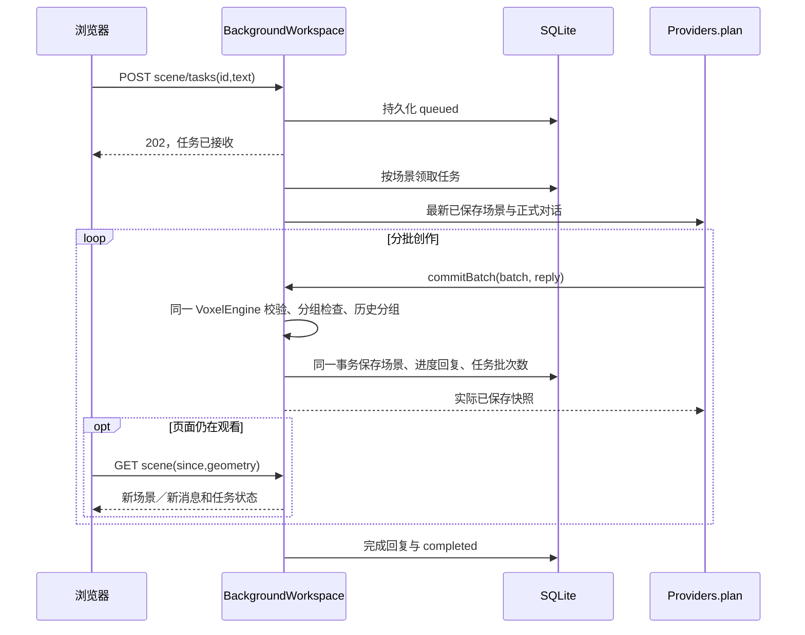

# 多场景与后台任务

核对：2026-10-11。当前工作区未提交；本轮用户已批准本机后端方案，交互效果待用户验收。

## 责任与存储

`server.ts → createApp(databasePath) → WorkspaceStore + BackgroundWorkspace → registerWorkspace`。

正式本机服务使用工程根目录 `.sayland/workspace.sqlite`（已忽略 Git），SQLite WAL / FULL 同步。目录只对当前用户开放。单元测试默认使用内存库，持久化测试自行创建并删除临时目录。前端 IndexedDB 只作为旧作品迁入来源；不再充当新场景的权威，也不覆盖或删除旧记录。

选择 Node 原生 `node:sqlite`，不增加 Redis、独立数据库服务或原生 npm 扩展。当前单 API 进程／本机单用户和少量并发任务适合 SQLite；多服务器并发写入与账户云同步不在本轮范围。SQLite 只在短事务中写入，不把模型请求包在数据库事务里。运行需要 Node 22.13+；当前实测 23.10.0 / SQLite 3.49.1，该 Node 版本仍会输出 SQLite 实验性 API 提示。来源：[Node 23.10 SQLite](https://nodejs.org/download/release/v23.10.0/docs/api/sqlite.html)、[SQLite 事务](https://sqlite.org/transactional.html)、[适用范围](https://sqlite.org/whentouse.html)，2026-10-11 核查。

| 数据 | 位置与约定 |
| --- | --- |
| 场景 | `scenes`：稳定 id、名称、初始模板、文档 version、resetKey、完整 version 1 作品和内核历史 |
| 任务 | `tasks`：稳定 id、sceneId、持久化排队序号、状态、原句、已提交批次数、结果、最近 16 条活动、原有有界诊断 |
| 手动命令 | `commands`：请求 id、目标场景、内容摘要，重发相同命令不会再次撤销／执行 |
| 退出封面 | `scene_previews`：独立 PNG BLOB 与 revision/resetKey/key/updatedAt；摘要只含元数据，不轮询传输图片，不改变作品格式或撤销历史 |
| 草稿和语音偏好 | 每场景保存，前端每5秒检查一次实际改动；未变不发保存请求，重复触发合并。返回首页、切换场景、重试及离页时仅补交未保存内容（离页 keepalive 尽力提交） |

项目导出格式仍为 `sayland-project / version:1`。新建空场景只有空内核；默认小岛沿用实际 `createInitialScene()`。首次命名不产生撤销历史。旧作品迁入按完整内容摘要生成稳定 id，重复启动不会重复导入；不替换后端现有场景。损坏的旧备份保留并明确提示，后台场景仍可打开。

## 执行链路

全局最多 4 个后台场景任务；同一场景最多 1 个，后续按持久化序号排队，并在真正开始时读取最新场景／对话。等待队列最多 64 条。模型原有工具、几何校验、分组、自由坐标、视觉反馈、6 分钟／24 次模型预算保持，每场景每分钟最多 24 次模型调用。每个任务 id 作为 `historyGroup`，一次撤销覆盖该任务所有已提交批次。

浏览器刷新、离页、关闭标签只结束读取与录音／播放，不取消已接收任务。`useHoldToTalk` 的失焦取消单独连接 `cancelRecording`，不会误停 AI。明确点击停止才调用 `/api/tasks/:id/cancel`。停止／失败保留此前已持久化批次，迟到提交拒绝；数据库写入失败则整批事务回滚，不能把内存修改算作已完成。

服务正常停止和进程崩溃后的重新启动都会将未结束任务标记 `interrupted`，保留作品、原句与进度；不自动重放未知结果的付费调用，也不让依赖上一项的排队任务盲目接着执行。用户查看已完成部分后重新提出想法。电脑休眠／关机／后端停止不能继续生成。

## HTTP 与界面

全部路由复用现有 loopback、Host、Origin、session 格式检查。场景库是本机单用户共享库，刷新产生新 session 仍可访问；不是账户权限系统，不可直接暴露到公网。

| 路由 | 行为 |
| --- | --- |
| `GET /api/workspace` | 场景摘要、全部活动任务和最近 40 条终态任务 |
| `POST /api/workspace/bootstrap` | 可选旧 project，幂等复制迁入；已删除的迁入项目返回 null，不重新创建；无 project 且没有场景时创建默认小岛 |
| `POST /api/scenes` | 指定 id、name、empty/island 创建场景；已删除的 ID 拒绝重建 |
| `DELETE /api/scenes/:id` | 幂等删除项目及关联数据，终止该项目运行任务、移除排队任务；其他项目不受影响 |
| `GET /api/scenes/:id?since=&geometry=` | 版本未变不返回 project；几何 revision/resetKey 未变则仅返回消息／偏好，不重复传输大场景历史 |
| `POST /api/scenes/:id/tasks` | 幂等提交 id/text；收到 202 表示已进入后台 |
| `POST /api/tasks/:id/cancel` | 明确停止指定任务 |
| `GET /api/tasks/:id` | 持久化任务诊断；不包含原始推理、音频或密钥 |
| `POST /api/scenes/:id/commands` | 期望 version + 幂等 id，支持 batch/rename/undo/redo/reset/import；场景有活动任务或版本过期时拒绝 |
| `POST /api/scenes/:id/preferences` | 草稿／语音偏好，不覆盖场景或对话 |
| `GET / POST /api/scenes/:id/preview` | 会话检查后读取／保存退出时的 PNG；上限 640×384 / 1 MiB，校验 PNG、CRC 和有界解压；拒绝 resetKey 不符、未来 revision 和早于已有封面的版本 |

`App → useWorkspaceWorkshop → workspaceApi`；根地址 `/` 显示 `ProjectHome`，仅轮询场景摘要与任务，不读取整场景、不挂载 Canvas。项目使用现有持久化 ID 形成 `/projects/<id>`，初次打开和刷新按该 ID 读取完整项目，加载期间显示读取状态；不使用上次项目缓存推断地址、不自动创建默认小岛。地址非法或 ID 不在已成功读取的工作区中时，替换为首页地址并显示原因；网络／场景读取失败保留原地址供重试。旧作品仍只读复制迁入。`SceneLibrary` 仅为首页的新建模板／后台任务弹窗，编辑器无新建入口。

`projectRoute.ts` 解析路径并复用 `workspaceId` 校验；`App` 在进入／创建成功后写入浏览器 History。前进／后退先还原当前历史项，再经同一退出保存对话；取消或保存失败不改原地址和项目，确认成功才完成历史跳转，保留前进记录。跨项目历史跳转先读取目标，失败不丢当前场景。仅两个页面，采用平台 [History API](https://developer.mozilla.org/en-US/docs/Web/API/History/pushState) 与 [popstate](https://developer.mozilla.org/en-US/docs/Web/API/Window/popstate_event)，未为此增加路由库；代价是本地维护保存阻塞和历史索引，回归见 `projectRoute.test.ts`。2026-10-11 核对。当前 Vite 开发／预览支持嵌套路径回退；未来静态托管需将非资源、非 `/api` 的页面请求回退到 `index.html`。

`switchScene` 在点击项目后读取完整场景。退出前若草稿未保存或保存失败，`App → ExitProjectDialog` 提供保存并退出／不保存退出／取消；已保存时直接完成正常退出。`leaveScene` 正常分支等待偏好保存，再由 `ScenePreviewCapture` 截取实际渲染帧并上传封面，全部成功才释放 Canvas。失败保留项目并在弹窗重试；退出期间禁用输入。取消保留当前编辑；不保存分支丢弃尚未发送的本地偏好、跳过截图与上传，首页维持上次封面。已经自动保存的模型、偏好和后台任务不回滚、不取消，在途已发送偏好也不承诺撤回。首页保持跨场景任务轮询，不触发完成朗读；保存状态按真实请求显示保存中、已自动保存或失败。

`ProjectHome → ProjectCover → readScenePreview` 使用现有会话头读取图片，替换／卸载时取消请求和释放 blob URL；无封面或读取失败时显示标明起点的模板插画。封面代表上次正常退出时实际看到的画面；后台继续生成不会伪造新封面。允许截图 revision 稍早于后台当前版本（退出时 AI 仍可提交），但不能覆盖更新的已保存封面；未保存或上传失败不改旧图。

当前场景创作期间仍可输入下一项。前端只渲染后台确认的内核数据；手动修改等待服务端提交，失败不伪装保存成功。恢复旧版本响应会被丢弃，切换场景隔离迟到回调。轮询逐次执行而非重叠，页面隐藏时暂停，卸载取消 GET 和计时器。仅正在观看时新完成的任务触发朗读／完成取景，重开页面不重播旧回复。

`app.ts` 的旧 `/api/chat` + `/api/turns/:id/ack` 及 `workshopTurn.ts::runWorkshopTurn` 保留为旧协议兼容和回归入口，当前 UI 不再调用它们；旧协议仍是浏览器 ACK 语义，不能把它当作后台任务入口。

## 定时保存与去重（2026-10-11）

用户要求：自动保存定时检查，场景没改动就不重复保存。`lib/sceneAutosave.ts → useWorkspaceWorkshop.flushPreferences` 每5秒只比较草稿与语音偏好这两个小字段，不周期序列化或上传完整场景。与后台任务有关的900/2500ms摘要轮询仅GET，不再夹带偏好保存；首页不运行偏好定时器，后台隐藏时暂停定时提交，离页／退出／重试仍仅补交未保存内容。模型命令和AI批次仍在实际修改时由后端即时事务提交，维持离页继续、每批持久化的既有约定。

以成功回执内容作保存基线；相同赋值、保存前改回原值不标脏，多个触发等待同一在途请求后重新比较最新值，不排队发送旧副本。保存中改回原值会补交最终值；响应丢失可能已提交，因此保留“结果未确认”标记，下一次重试确认最新内容后才显示已保存。选择不保存／删除会使尚未发送的旧请求失效；读取响应跨越保存回执时不反向覆盖当前草稿。

后端 `BackgroundWorkspace.preferences` 对相同字段直接返回，不写SQLite，也不更新项目version/updatedAt。正常退出仍截取当前视角，先比较场景revision/resetKey与viewKey（渲染策略版本、画布尺寸、相机矩阵），相同则不上传；旧封面缺少viewKey时以revision/resetKey/PNG的SHA-256继续去重。`savePreview` 对重复请求也直接返回原元数据，不改BLOB或时间。不能只比较PNG：AO随机采样会让相同场景／视角产生少量像素差异。转动或缩放后的新视角依然正常更新封面；不保存退出仍保留旧图。

回归：`sceneAutosave.test.ts` 覆盖未变／改回、并发合并、保存中再改／还原、丢弃、响应不明后的确认；`workspace.test.ts` 用SQLite写入计数验证重复偏好／封面和状态读取不产生更新，实际改动只写一次。

验证：24项相关测试、类型检查、临时目录前后端构建通过。隔离浏览器／SQLite计数实测静置和保存前改回原样均为0次保存请求／写入，单次草稿修改为1次；默认小岛相同版本／视角再次退出无新增封面请求或写入，缩放后退出新增1次。测试页、4315/4316服务及临时数据库／构建已清理，4310/4311在确认无活动任务后重启并加载当前代码。未调用真实模型或修改用户项目；效果待用户验收。

## 首页删除项目（2026-10-11）

`ProjectHome → DeleteProjectDialog → useWorkspaceWorkshop.removeScene → DELETE /api/scenes/:id → BackgroundWorkspace.deleteScene → WorkspaceStore.deleteScene`。入口在首页卡片右上角，与进入按钮独立；弹窗明确项目名称、不可恢复的数据范围及活动任务数量。确认前不修改数据；提交中禁用重复操作，失败留在弹窗供重试，成功移除项目卡和关联任务。

后端以单个同步事务删除 `scene_previews / commands / tasks / scenes`，包含全部终态任务而非只清理列表中的最近40条；成功后立即 abort 该场景全部运行控制器，清掉调用计数。排队任务已不在数据库中，不会被领取；已领取回调检查 AbortSignal，任务消失后的收尾直接结束，不写回数据，也不把正常删除误判为全局存储故障。事务失败不 abort，原项目和任务保持；重复 DELETE 可安全重试。模型请求复用已有 fetch AbortSignal，不新增调用。

`deleted_scenes` 仅保留已删除 ID（不保存名称、模型、对话或其他项目内容），防止迟到 create 或旧备份自动迁入重新生成项目。原浏览器备份、用户导出的外部文件不在后台删除范围。旧页面的偏好／编辑／任务／封面请求因项目不存在而拒绝；已打开项目的页面在下次可见轮询确认项目消失后回到首页，释放画布与本地媒体。首页用请求代数忽略删除前发出的迟到摘要，避免卡片短暂复活。暂停在后台的页面恢复可见时再检查。

验证：`workspace.test.ts` 新增运行中＋排队删除、迟到批次／消息／最终结果、其他项目继续、重启后不恢复、旧 ID 重建与自动迁入阻断、会话／Origin 边界、事务失败完整回滚。隔离4315/4316实际API验证只对目标模型调用发出abort，另一项目继续运行；浏览器验证确认／保留、模拟503错误、390×844弹窗布局，以及已打开项目被删除后回首页（Canvas为0）。未删除正式用户项目或调用真实模型。效果待用户验收，未提交。

## 验证与边界

`test/workspace.test.ts` 覆盖：响应结束后独立分批提交、整轮撤销与幂等、同场景顺序／跨场景 4 并发、取消后迟到拒绝、排队停止、磁盘重开、崩溃标记、旧备份幂等迁入、过期写入及访问边界、场景＋任务事务回滚、封面磁盘恢复及无效／过期图片不覆盖旧图。无真实供应商调用。

实际浏览器使用隔离 4315/4316 服务、临时 SQLite 和明确标记的模拟模型：创建两个空场景，两个任务同时进行并追加同场景排队任务；关闭该服务全部页面后释放模拟模型，3 个任务均完成，各 2 批；重新打开读取到 108／54 个方块和完整回复。默认小岛246146格创建、1280×720／390×844／844×390实际渲染、新建选项、横屏纵向滚动及无横向溢出亦已检查；重新打开后的控制台无应用错误，保留既有Three.js Clock弃用提示。开发期间并行修改Hook曾产生热更新顺序报错，关闭后重开恢复；未把该中间态算作页面通过。107项目标回归、TypeScript和前后端构建通过。测试不改变正式库中的用户作品。真实模型造型、麦克风／扬声器和用户主观效果需对应验收。

封面与退出补充验证（2026-10-11）：隔离浏览器验证真实 PNG 生成、刷新恢复、不保存后封面元数据完全不变、取消保留草稿、模拟 503 留在项目及恢复保存退出；保存成功后封面更新而模型格数不变。桌面和 390×844 窄屏检查通过，返回首页 Canvas 为0。工作区与按住说话12项定向回归通过；无真实供应商调用，视觉效果待用户验收。

最终集成：类型检查、前后端临时目录构建及工作区／按住说话／路由17项回归通过。正式4310/4311在活动任务归零后重载，已通过大米岛实际进入／退出验证封面生成，模型仍为116690格；其他未退出项目保持原封面。临时4315/4316测试服务、数据库、缓存和构建已清理，正常预览保留。

删除最终检查：工作区／路由／按住说话19项回归、类型检查及前后端临时目录构建通过。正式服务在任务为空时重载，首页删除入口与保留项目操作已确认；未执行正式项目删除。隔离测试页／服务／数据库／缓存／构建均已清理，4310/4311正常预览保留。
